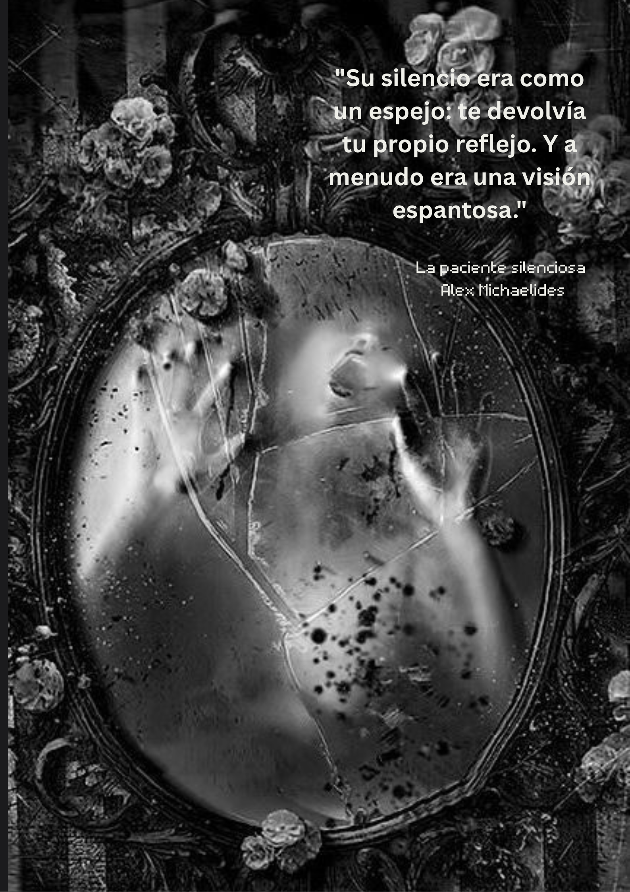

{:width="400" style="float: left"}

Alicia Berenson, está dedicada a la pintura, aparentemente vive una vida feliz, pero asesina cruelmente a su esposo y cae en un mutismo, y no vuelve hablar ni a comunicarse con nadie. Es trasladada a un centro de reclusión donde ve pasar el tiempo hasta que llega un terapeuta llamado Theo Faber  muy interesado en su caso.

Theo tiene problemas con su esposa que no logra lidiar, ni resolver. Se postula para el cargo de terapeuta en el centro donde esta confinada Alicia. Allí logra que ella retome la pintura e intenta que vuelva hablar.

Es una novela acerca de la psique humana, narrada a dos voces y en primera persona por los dos protagonistas, Alicia Berenson y Theo Faber, aunque será este último quien lleve todo el peso de la narración ya que es él quien cuenta la historia y la parte de Alicia se muestra a través de su diario. 

Así, la historia es contada por un lado por Alicia a través de su diario, que es el hilo conductor entre el relato y el desenlace de la novela y por el otro por Theo que cuenta los hechos en el presente.

La acción comienza en el hospital The Grove, una unidad forense de seguridad en Edgware, al  norte de Londres, después de los acontecimientos desencadenados seis años atrás,  en el noroeste de Londres, junto al gran parque de Hempstead  Heath. De esta forma, la historia puede que en momentos se vuelva  escalofriante, sobre todo intrigante, pero no deja al lector insatisfecho con la lectura. Un personaje femenino enigmático con el cual se intenta empatizar, hacerlo cercano aunque desde el inicio la culpabilidad está presente. 

El asesinato de su marido y la mudez de Alicia Berenson atrapan el interés de toda Inglaterra.  Su silencio es un grito hacia la verdad, la cual solo se descubre en el último capítulo del libro.  

A partir de ese momento, deja de hablar, pero si ofreció una declaración, a través de un cuadro: Alcestis. Tras asesinar a su marido Alicia se pinta a sí misma, en  un inquietante cuadro pocos días después del suceso, en él hace referencia al mito de Alcestis, una tragedia griega que nos habla de un sacrificio, como observamos en este ejemplo:  ´´Alcestis: el título que Alicia le puso a su autorretrato, el que pintó tras el asesinato de Gabriel´´.   

La infidelidad de Gabriel y Kathy  va a ser el desencadenante que provoca la tragedia. A esto, se suma  la falta de profesionalidad de Theo  que se involucra en forma personal con los acontecimientos que se están desarrollando.  Theo acosa en secreto a Alicia y a Gabriel. Una noche, Theo irrumpe en la casa de ellos armado. Ata a la pareja y pone a Gabriel ante una cruel elección: salvar su propia vida o la de Alicia. Gabriel elige salvarse a sí mismo.  Alicia se quiebra. Theo se marcha sin disparar, pero Alicia, rota por la traición, desata a Gabriel y le dispara cinco veces en la cara. Desde ese instante, decide no volver a hablar jamás.

Es una novela que atrapa a medida que pasan las páginas, obligándonos a pensar constantemente en su título. En *La paciente silenciosa*, Alicia protagoniza una tragedia criminal donde el asesinato se entrelaza trágicamente con los traumas infantiles. Se trata de un drama con un motivo claro pero oculto: una trama de infidelidad en matrimonios aparentemente estables narrada con absoluta intriga. Ante la ausencia de la palabra oral, la escritura y la pintura se convierten en las únicas pruebas —inicialmente no validadas— que terminan condenándola a un hospital psiquiátrico.

Igual que Admeto había condenado físicamente a Alcestis a morir, Vernon Rose había condenado psicológicamente a la muerte a su hija Alicia.  Lo que hizo fue un acto de infanticidio psicológico, como lo expresa Faber. De ahí que, la furia asesina  de Alicia, no nace en el presente.  Se origina en su infancia,  y con el paso de los años va acumulando esa carga hasta que estalla, a menudo contra un blanco equivocado. Alicia escucha estas palabras terribles  en boca de su padre:  ´´—Vernon no hacía más que hablar de lo mucho que quería a Eva, que no podía vivir sin ella. «Mi niña», repetía sin parar. «Mi pobre niña, mi Eva... ¿Por qué ha tenido que morir? ¿Por qué ha tenido que ser ella? ¿Por qué no ha muerto Alicia en vez de ella?´´.  

{:width="400" style="float: right"}

Esto se vuelve a repetir con Gabriel Berenson, cuando Alicia descubre su traición, situación que no puede soportar al recordar la terrible traición de su padre.  Lo que hace que, se desencadene la tragedia, y por eso, completó la esperada venganza contra su padre, en la persona de su marido, Es su segunda muerte.  Y ante ello, explota, y va a cobrarse la rabia largamente contenida, como observamos a continuación:  ´´Por fin lo veía. Jamás estaría a salvo. Jamás sería amada. Todas mis esperanzas, perdidas; todos mis sueños, destrozados. Mi padre tenía razón, no merecía estar viva. No era nada. Eso fue lo que me hizo Gabriel. Esa es la verdad. Yo no maté a Gabriel: él me mató a mí, Lo único que hice yo fue apretar el gatillo´´.

##### *"*La muerte de la empatía humana es uno de los primeros y más reveladores signos de una cultura a punto de caer en la barbarie".  *Hannah Arendt.   1.951.*

#### El silencio como un grito mudo:

{:width="300" style="float: right"}  La novela explora el poder del silencio, no solo como una ausencia de palabras, sino como un grito mudo, revelando secretos y verdades ocultas. En un género donde el diálogo y la acción suelen dominar, Michaelides demuestra que el silencio puede ser más elocuente y cómplice.

Cada capítulo se siente con una tensión que se construye no a través de lo que se dice, sino de lo que se deja de decir. El silencio de Alicia Berenson refleja su sensación de traición de toda la vida: primero su padre y luego Gabriel. El asesinato de Gabriel tenía unos orígenes más antiguos y más profundos al buscar la venganza que no pudo realizar con el padre. 

{:width="300" style="float: left"}Uno de los aspectos que más intriga fue cómo el silencio funciona como un poderoso símbolo.  Alicia no solo calla en el sentido literal, sino que también simboliza todos los secretos y traumas no resueltos. Este silencio se convierte en una forma de poder y de resistencia. En el caso de Alicia, su silencio puede verse como una manifestación de lo indecible, de aquellas experiencias y traumas que son demasiado abrumadores para ser articulados en palabras.

El lector se pregunta si, al no hablar, Alicia no solo se protegía a sí misma, sino que también desafiaba a quienes intentaban descubrir la verdad.  No es un silencio vacío, sino uno cargado de significado y emoción. Es un silencio que habla, que cuenta una historia sin palabras que transmite dolor y trauma.

Otra forma de silencio lo observamos en la conducta de Kathy Faber. La trayectoria de Kathy a lo largo de la novela ilustra la complicada dicotomía entre el silencio y el habla: mientras que Kathy comienza como uno de los personajes más habladores y abiertos, al final de la historia, está casi totalmente en silencio, envuelta en una tranquila depresión propia de quien ha sufrido una pérdida para lo cual no estaba preparada y poco a poco se va encerrando en sí misma.

Pero ese silencio no solo lo manifiesta Alicia. Gabriel, Kathy y Theo también están envueltos en una red de complicidad y conexión; sus traumas y dolores se entretejieron como hilos invisibles para transformarlos en marionetas. Esta historia reafirma cómo la subvaloración de la inteligencia emocional condiciona trágicamente el comportamiento humano.

Una mina de oro para el análisis psicológico. Desde la inteligencia emocional (IE) y la neurociencia, los "hilos invisibles" no son metáforas: mecanismos biológicos y emocionales reales. Es decir, con la finalidad de puntualizar el repensar para pensar:

1.-Ninguno de los personajes sabe identificar qué siente. Analfabetismo emocional.

2.- La incapacidad de gestionar lo que se piensa. No hay autocontrol.

3.- No hay empatía ni cognitiva ni emocional. Cada uno en su isla con sus soldados.

Se abre un abanico de preguntas, pero una de ellas destaca sobre las demás: ¿Dónde queda la responsabilidad individual cuando se acciona buscando siempre un culpable externo? En psicología y neurociencia, a esto se le llama Locus de Control Externo. Al final, las historias repiten la misma causa raíz: la infancia. No hay nada más que decir.

#### Las doncellas:  TheoFaber en susinicios de psicólogo forense.

Alex Michaelides estuvo rodeado por los dioses desde niño, los mitos griegos tuvieron un papel determinante en su educación. Como el mismo autor lo declara a la revista Lengua ´´desde que tengo uso de razón, los mitos han nutrido mi imaginación y han supuesto una fuente de inspiración. Me encanta formar parte de esta relectura de los mismos desde una perspectiva moderna porque conservan toda su fuerza psicológica y narrativa´´.

En su nueva novela, *Las doncellas* relata la peripecia en la que se ve envuelta Mariana Andros, una psicoterapeuta que deja la terapia de grupo  en Londres. y viajará hasta Cambridge, donde estudia Literatura Inglesa su sobrina Zoe, la única familia que le queda, para consolarla tras la violenta muerte de Tara, su amiga íntima. Zoe y Tara iban juntas al Saint Christopher’s College de la Universidad de Cambridge. Tara formaba parte de una sociedad secreta denominada Las Doncellas, bajo la égida  del profesor de Filología Clásica Edward  Fosca.

Esta vez, el investigador especializado en la psique humana es Mariana Andros, y la ambientación es en Cambridge, aunque el autor no da demasiados datos ni se explaya en descripciones, sí logra sumergirnos en ese ambiente universitario de estudiantes y  profesores. 

{:width="300" style="float: left"}Aunque *Las doncellas* es posterior a *La paciente silenciosa*, la historia que aquí nos relatan es simultánea a los hechos ocurridos en *La paciente silenciosa*. Nos encontramos a un Theo Faber trabajando en The Grove, atendiendo a Alicia Berenson.

Theo era psicólogo forense. Se había formado con Mariana la protagonista, en Londres.  A pesar de que compartían a Ruth como supervisora, apenas se conocían. En *Las doncellas* nos describen a un Theo profesional, como lo habíamos visto al principio de la novela *La paciente silenciosa*.  Atiende  a Zoe la sobrina de Mariana, y a Alicia Berenson, una guapa pelirroja en  The Grove, la unidad psiquiátrica de seguridad que había en Edgware, al norte de Londres.

Theo trata a Zoe, que ha intentado suicidarse varias veces, antes de  sufrir una grave crisis psicótica.  Quiso ponerse en contacto con Mariana en numerosas ocasiones por el asunto de Zoe, y al no recibir respuesta, Mariana recibió  una carta de Theo, donde le pedía que reconsiderara una vez más su negativa a ver a Zoe, que estaba empezando a  hablar del mundo secreto que compartía con Sebastián, el difunto esposo de Mariana. En su tratamiento con Zoe la insta a verla. Ella accedió y Theo le dice:  ´´—Creo que es algo más complicado, Mariana —vaciló un instante—. El que intentó matarte fue él. Ella no fue más que la mano ejecutora. Su marioneta. Estaba completamente a su merced´´.
