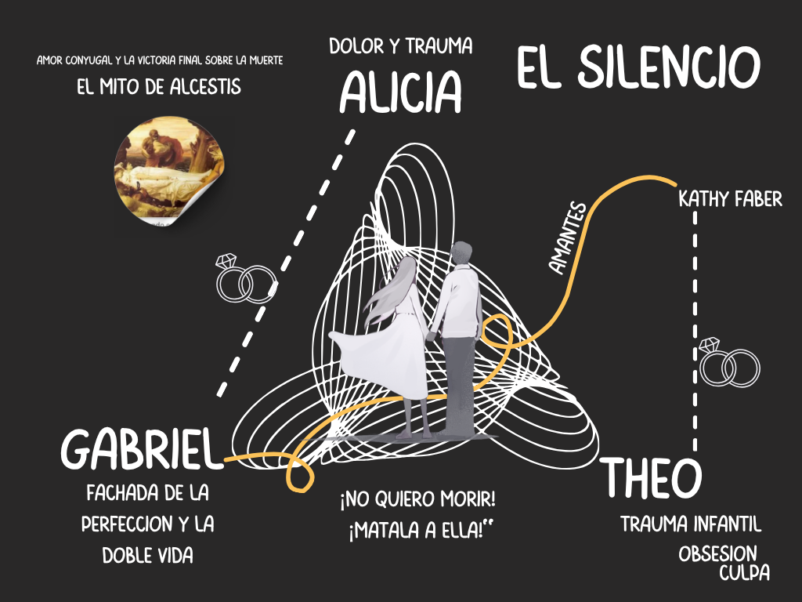

{:width="400" style="float: left"}

Alicia Berenson, está dedicada a la pintura, aparentemente vive una vida feliz, pero asesina cruelmente a su esposo y cae en un mutismo, y no vuelve hablar ni a comunicarse con nadie. Es trasladada a un centro de reclusión donde ve pasar el tiempo hasta que llega un terapeuta llamado Theo Faber  muy interesado en su caso.

Theo tiene problemas con su esposa que no logra lidiar, ni resolver. Se postula para el cargo de terapeuta en el centro donde esta confinada Alicia. Allí logra que ella retome la pintura e intenta que vuelva hablar.

Es una novela acerca de la psique humana, narrada a dos voces y en primera persona por los dos protagonistas, Alicia Berenson y Theo Faber, aunque será este último quien lleve todo el peso de la narración ya que es él quien cuenta la historia y la parte de Alicia se muestra a través de su diario. 

Así, la historia es contada por un lado por Alicia a través de su diario, que es el hilo conductor entre el relato y el desenlace de la novela y por el otro por Theo que cuenta los hechos en el presente.

La acción comienza en el hospital The Grove, una unidad forense de seguridad en Edgware, al  norte de Londres, después de los acontecimientos desencadenados seis años atrás,  en el noroeste de Londres, junto al gran parque de Hempstead  Heath. De esta forma, la historia puede que en momentos se vuelva  escalofriante, sobre todo intrigante, pero no deja al lector insatisfecho con la lectura. Un personaje femenino enigmático con el cual se intenta empatizar, hacerlo cercano aunque desde el inicio la culpabilidad está presente. 

El asesinato de su marido y la mudez de Alicia Berenson atrapan el interés de toda Inglaterra.  Su silencio es un grito hacia la verdad, la cual solo se descubre en el último capítulo del libro.  

A partir de ese momento, deja de hablar, pero si ofreció una declaración, a través de un cuadro: Alcestis. Tras asesinar a su marido Alicia se pinta a sí misma, en  un inquietante cuadro pocos días después del suceso, en él hace referencia al mito de Alcestis, una tragedia griega que nos habla de un sacrificio, como observamos en este ejemplo:  ´´Alcestis: el título que Alicia le puso a su autorretrato, el que pintó tras el asesinato de Gabriel´´.   

La infidelidad de Gabriel y Kathy  va a ser el desencadenante que provoca la tragedia. A esto, se suma  la falta de profesionalidad de Theo  que se involucra en forma personal con los acontecimientos que se están desarrollando.  Theo acosa en secreto a Alicia y a Gabriel. Una noche, Theo irrumpe en la casa de ellos armado. Ata a la pareja y pone a Gabriel ante una cruel elección: salvar su propia vida o la de Alicia. Gabriel elige salvarse a sí mismo.  Alicia se quiebra. Theo se marcha sin disparar, pero Alicia, rota por la traición, desata a Gabriel y le dispara cinco veces en la cara. Desde ese instante, decide no volver a hablar jamás.

Es una novela que atrapa a medida que pasan las páginas, obligándonos a pensar constantemente en su título. En *La paciente silenciosa*, Alicia protagoniza una tragedia criminal donde el asesinato se entrelaza trágicamente con los traumas infantiles. Se trata de un drama con un motivo claro pero oculto: una trama de infidelidad en matrimonios aparentemente estables narrada con absoluta intriga. Ante la ausencia de la palabra oral, la escritura y la pintura se convierten en las únicas pruebas —inicialmente no validadas— que terminan condenándola a un hospital psiquiátrico.

Igual que Admeto había condenado físicamente a Alcestis a morir, Vernon Rose había condenado psicológicamente a la muerte a su hija Alicia.  Lo que hizo fue un acto de infanticidio psicológico, como lo expresa Faber. De ahí que, la furia asesina  de Alicia, no nace en el presente.  Se origina en su infancia,  y con el paso de los años va acumulando esa carga hasta que estalla, a menudo contra un blanco equivocado. Alicia escucha estas palabras terribles  en boca de su padre:  ´´—Vernon no hacía más que hablar de lo mucho que quería a Eva, que no podía vivir sin ella. «Mi niña», repetía sin parar. «Mi pobre niña, mi Eva... ¿Por qué ha tenido que morir? ¿Por qué ha tenido que ser ella? ¿Por qué no ha muerto Alicia en vez de ella?´´.  

{:width="400" style="float: right"}

Esto se vuelve a repetir con Gabriel Berenson, cuando Alicia descubre su traición, situación que no puede soportar al recordar la terrible traición de su padre.  Lo que hace que, se desencadene la tragedia, y por eso, completó la esperada venganza contra su padre, en la persona de su marido, Es su segunda muerte.  Y ante ello, explota, y va a cobrarse la rabia largamente contenida, como observamos a continuación:  ´´Por fin lo veía. Jamás estaría a salvo. Jamás sería amada. Todas mis esperanzas, perdidas; todos mis sueños, destrozados. Mi padre tenía razón, no merecía estar viva. No era nada. Eso fue lo que me hizo Gabriel. Esa es la verdad. Yo no maté a Gabriel: él me mató a mí, Lo único que hice yo fue apretar el gatillo´´.
