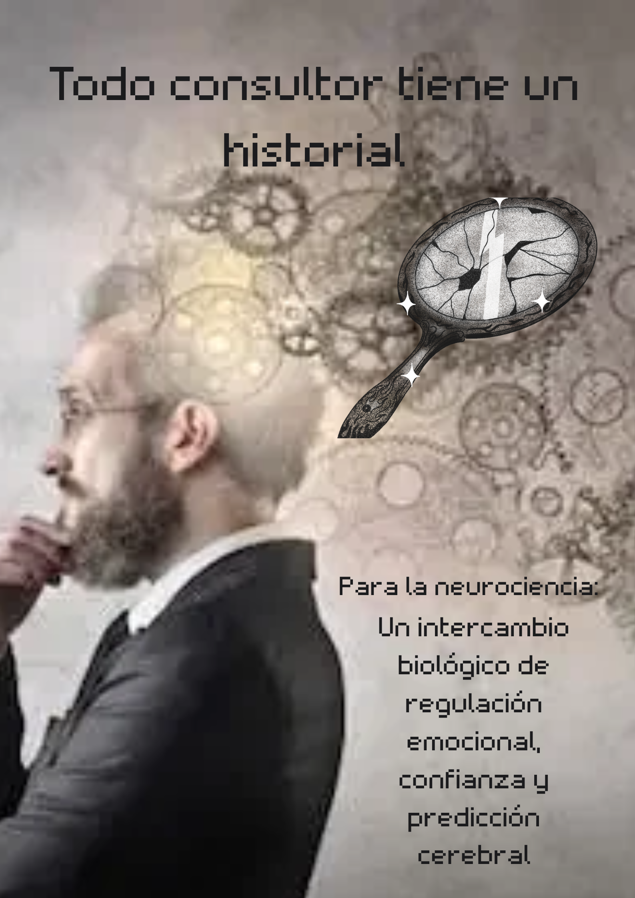

{:width="300" style="float: right"} 

##### Alicia Berenson

{:width="300" style="float: left"}De ojos azules profundos, rostro de simetría perfecta, larga melena pelirroja, hombros huesudos, piel translúcida. Estuvo felizmente casada con Gabriel, durante siete años. Ambo serán artistas:  ella era una brillante pintora, cada vez más cotizada y él un fotógrafo de prestigio, con una vida aparentemente perfecta. Alicia admira a Gabriel y estaba totalmente enamorada de él, ama y adora a su marido, como ella misma lo expresa en su diario:   ´´Amo muchísimo a Gabriel. Es, sin lugar a dudas, el amor de mi vida.  Lo quiero de una forma tan completa, tan absoluta, que a veces ese sentimiento amenaza con superarme´´.  

Nació en Cambridge. Allí pasó los primeros dieciocho años de su vida, donde se había formado su personalidad. Alicia no tenía  más de diez  años cuando ocurrió el accidente de tráfico en el que murió su madre, que no fue tal, según palabras de la  misma Alicia:  ´´He pensado en mi madre. ¿Estaba loca? ¿Por eso lo hizo? ¿Por eso me ató con el cinturón de seguridad al asiento del acompañante de su mini amarillo y aceleró hasta estrellarnos contra esa pared de ladrillo rojo? ´´.  

Luego de la muerte de la madre oye a su padre decir que ella era la que debió morir y no su madre. De ahí, que el asesinato de Gabriel tenía unos orígenes más antiguos y más profundos en un trastorno de su mundo interior.  Intentó suicidarse  con una sobredosis después de la muerte de su padre. Había heredado  una fortuna de Vernon  Rose.  Precisamente, en este ejemplo se explica:  ´´La furia asesina, la furia homicida, no nace en el presente. Se origina en ese territorio anterior a la memoria, en el mundo de la primera infancia, a causa de abusos o malos tratos a una edad temprana, y con el paso de los años va acumulando carga hasta que estalla; a menudo contra un blanco equivocado´´.  

Alicia contaba con un largo historial de problemas de salud mental, que se remontaban a su infancia a través de cambios de humor, ira, arrebatos violentos, romper cosas hasta destrozarlo todo. Esa inestabilidad emocional la refleja en su diario que fue un regalo de Gabriel, era más bien, un pequeño cuaderno de tapas de cuero negro y unas páginas blancas y gruesas. Su marido le sugiere la idea de escribir.  Al principio se muestra reacia, pero  luego, acepta la propuesta para calmar la preocupación de Gabriel por su estado emocional.  Lo escribió durante los meses anteriores hasta las semanas previas a la muerte de su esposo, donde va relatando sus inquietudes y sentimientos más íntimos del pasado, con algún salto temporal a la actualidad.  Así, nos adentramos en su psique, y observamos que:  ´´A juzgar por la letra, lo había escrito en un estado mental caótico´´.  Entendiendo, una mente llena de pensamientos atrapados, repetidos, acciones olvidadas y agotamiento mental.  

En la novela, ya hace seis años que Alicia Berenson, una noche, según la evidencia encontrada, le disparó cinco tiros en la cabeza a su marido. Nadie acierta a entender qué la impulsó a llevar a cabo el asesinato de Gabriel.  Después ella trató de quitarse la vida. Conservaba cortes profundos que le cruzaban las venas en las muñecas, la llevaron al Royal Free Hospital.  Sufrió un colapso y quedó inconsciente; pero sobrevivió. Se autolesionaba con cualquier cosa que llegara  a sus manos.

Es acusada del homicidio de su marido e internada en un psiquiátrico. No ha vuelto a pronunciar palabra, ni siquiera para tratar de defenderse en el juicio que se le siguió. La única pista sobre la que indagar es un cuadro que pintó en los días siguientes al crimen, que tituló Alcestis. Theo Faber se entera de que el nombre hace alusión a una tragedia  escrita por Eurípides en la antigua Grecia, que será clave en el transcurso de la historia: ´´El cuadro es un autorretrato en el que se ve a Alicia en el estudio de su casa los días posteriores al asesinato, de pie delante de un caballete y un lienzo, con un pincel en la mano.  De él gotea pintura roja, ¿o es sangre?´´.  

Vemos  que la ruptura con  la realidad a través del silencio y la psicosis que presenta Alicia eran en parte sus formas de lidiar con el dolor insuperable causado por el hombre que amaba al descubrir su traición. No solo le había sido infiel, sino que también había sido responsable de la cadena de eventos que llevaron a la noche traumática.

De Alicia Berenson se comprende la influencia de la mente humana, el dolor y las relaciones. En resumen: el mutismo es un mecanismo de defensa, pero sus manos con el pincel y el bolígrafo gritaron su sentir ante una historia de traumas. No hay un silencio absoluto, como tampoco la herencia es determinante así sea un portador de generaciones.

{:width="300" style="float: right"}Otra reflexión, es la utilidad de herramientas. Tanto la pintura como la escritura son recursos de expresión, buscando un equilibrio entre el pensar y el sentir. En el caso de Alicia los utilizó para describir el asesinato, que se convirtieron en pistas a investigar.

Retomando ser portadora, las diferentes situaciones vividas en la infancia marcan el presente. Como Menelao en la Odisea: “La sangre de tus padres no se pierde…”  La epigenética dice que el entorno y los hábitos pueden anular la participación de los genes. En el caso de Alicia, el entorno fue determinante para reactivar la herencia. El accidente en el auto donde estaban la madre y ella, por ejemplo.

Una infancia traumada y un presente de traición. Una vez más, dependencias, obsesiones, secretos oscuros y una alarmante falta de salud mental. “Una mente incapaz de «anular el miedo» es precisamente la más peligrosa ...” Siddhartha Mukherjee.

#### Theo Faber

{:width="300" style="float: left"}Tiene cuarenta y dos años, de ojos negros, rostro agradable, afectuoso, mirada angustiosa, casi obsesiva, constitución delgada.  Creció rodeado de una tensión constante a causa del maltrato infantil, inseguridades y traumas, producto de la relación con su padre, porque nunca se sintió seguro cuando lo tenía cerca:  ´´Si hoy en día lo hubiera examinado un psiquiatra, sospecho que a mi padre le habrían diagnosticado un trastorno de la personalidad.

Faber es un personaje muy complicado que estaba traumatizado por un padre violento y tirano y una madre incapaz de ayudarlo. Intento suicidarse. Tenía que entender lo que le pasó cuando era niño, también tenía que entender lo que le pasó a sus padres cuando eran niños. De lo contrario, nunca podría perdonar realmente y nunca podrá superar las cosas, en la construcción de su conducta de adulto. El mismo se siente como: ´´Un niño pequeño a punto de estallar de ansiedad, albergando en su interior todos sus terrores, todo su dolor; caminando de un lado a otro sin pausa, sin  descanso, asustado; solo ante el miedo al loco de su padre´´. 

En la universidad a través del servicio de orientación fue remitido a una psicoterapeuta Ruth. Con ella, estableció una relación basada en el respeto mutuo, porque su infancia y adolescencia estuvieron dominadas por la violencia física.  Encontró su vocación a los dieciocho años: ´´Era evidente que la psicoterapia me había salvado la vida, literalmente. Y lo que era más importante, había transformado la calidad de esa vida. La «cura del habla» se convirtió en un aspecto central de la persona en la que me convertí; en un sentido muy profundo, me definía´´. 

La  psicoterapia le había transformado la calidad de vida.  Al acabar la universidad, se formó como psicoterapeuta en Londres. De ahí, según el mismo que su motivación para esa profesión fuera egoísta, porque:  ´´Lo que buscaba era ayudarme a mí mismo. Creo que eso nos ocurre a la mayoría de los que nos dedicamos a la salud mental. Nos atrae esta profesión porque estamos heridos; estudiamos psicología para sanarnos´´.  

Lo que vivió hasta la adolescencia lo hace escapar del hogar, logra conseguir una beca para estudiar psicoanálisis, en parte para aliviar sus males, matar sus fantasmas y enfrentar sus demonios para sanar sus propias heridas.

Fumaba marihuana desde la universidad. Estaba demasiado herido y era incapaz de compartir intimidad con nadie, hasta que conoció a Kathy y se enamoró. Trabajaba en el hospital psiquiátrico de Broadmoor y luego, buscó plaza como psicoterapeuta forense en el hospital The Grove. El objetivo del ambicioso Theo Faber al ingresar al psiquiátrico es convertirse en el terapeuta de Alicia  para tratar de que vuelva a hablar y busca aclarar el misterio de su silencio.

{:width="300" style="float: right"}Theo se posiciona de su papel de ayudador, protector y redentor. Su obsesión insana hacia Alicia  hace que Faber, con la excusa de la terapia, realice una investigación particular al  entrevistar a  todas las personas que pudieran arrojar  luz  sobre el asesinato.  Sus acciones van encaminadas a descubrir lo que sucedió esa fatídica noche en que Alicia asesinó a sangre fría a su marido.  

Theo se va adentrando en su vida personal y en sus propios demonios producto de sus traumas  de la infancia, las razones que le llevaron a estudiar y de por qué se hizo psicoterapeuta, los problemas en el hospital psiquiátrico con algunos de sus colegas  y con los pacientes, su relación con su mujer y cómo vive la infidelidad que le descubre. 

Vemos que detrás de todo su interés en Alicia se oculta una intención muy personal, que está enquistada en su propio pasado y en la que Faber oculta sus cicatrices psicológicas, al esconder sus vulnerabilidades que lo han llevado a cometer actos inimaginables cuando se desvele la realidad, en un inesperado final que lo cambiará todo.

**Hay que escribirlo en letras subrayadas: Faber es unterapeuta; que por sus acciones denota una corriente de dudas sobre el sistema de salud psicológica.** Su interacción con Alicia pone la dinámica entre consultado y consultante en una manipulación por parte de él, sembrando sospechas sobre la efectividad de la terapia y el peso del tiempo de la escucha activa. ¿Qué tan efectivos son los acuerdos cuando la mente es un laberinto? ¿Incumplió el código ético el consultor? ¿Esta interacción está distante de la realidad? ¿El consultor analiza lo que piensa y siente? 

Al igual que Theo, todo consultor tiene un historial, la diferencia es que hay que tomar conciencia de las consecuencias de manipular al consultado y a su vez, se pone al descubierto que el cerebro no distingue entre realidad y ficción. Theo perdió la realidad.

##### Personajes cercanos con Alicia Berenson y Theo Faber:

{:width="300" style="float: left"} 
**Gabriel Berenson**:  esposo de Alicia, de elevada estatura, pelo oscuro, rasgos apuestos, mandíbula fuerte, pómulos altos, nariz elegante, corpulento, grácil, piernas fuertes  y muslos gruesos, tenía cuarenta y cuatro años,   ordenado, era un fotógrafo de moda muy conocido. Fotografiaba  a mujeres medio anoréxicas y medio desnudas desde ángulos fuera de lo común.  Sin embargo, parecía más un actor de cine que un fotógrafo.

Tenía una situación económica holgada. Le dejó el grueso de su patrimonio a su hermano. Según Max Berenson era un marido abnegado y muy enamorado de su mujer.  Gabriel era crucial en la vida emocional de Alicia. Era bastante posesivo, pero también, una fuente de angustia, porque  tenía un lado que asustaba a Alicia:  ´´Gabriel tiene un lado agresivo, una parte de él que solo atisbo en ocasiones, y cuando lo hago, me asusta. Durante esos breves momentos es como vivir con un extraño. Y es aterrador´´. 

Esa aparente devoción se demostró al momento de decidir por su vida y no por la de Alicia o de ambos, lo que ocasionó su muerte por la reacción de Alicia al propinarle cinco disparos con la pistola que dejó el intruso ( Theo) olvidada..

Gabriel es un personaje que se sale de lo convencional. Sus fotografías de mujeres que en cierto modo han perdido la belleza, mujeres sumamente delgadas en contraposición a él, el fotógrafo, con su apariencia de actor. Su relación con Alicia tenía sus altibajos que solo ellos conocían. Mostraba un afecto y devoción a Alicia, haciendo que ella lo necesitara en su vida emocional, pero tenía sus momentos donde aparecían sus rasgos agresivos.

**Kathryn/Kathy Faber:**  esposa de Theo, joven y hermosa, de larga melena negra, ojos verdes penetrantes. Era estadounidense, había nacido y crecido en el Upper West Side deManhattan. Su madre inglesa le permitió doble nacionalidad.  Pasó por la escuela de arte dramático y al final del primer año firmó con un agente, y empezó a actuar profesionalmente.

Antes de Theo, salía con un australiano que se llamaba Daniel, pero él no quería casarse ni tener hijos en un futuro próximo, así que consideró  que estaba perdiendo el tiempo.  Y conoció a Theo que también tenía pareja: Marianne.  Ambos dejan a sus anteriores parejas y se unen.
