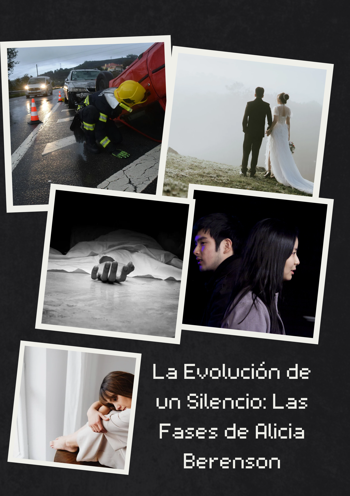
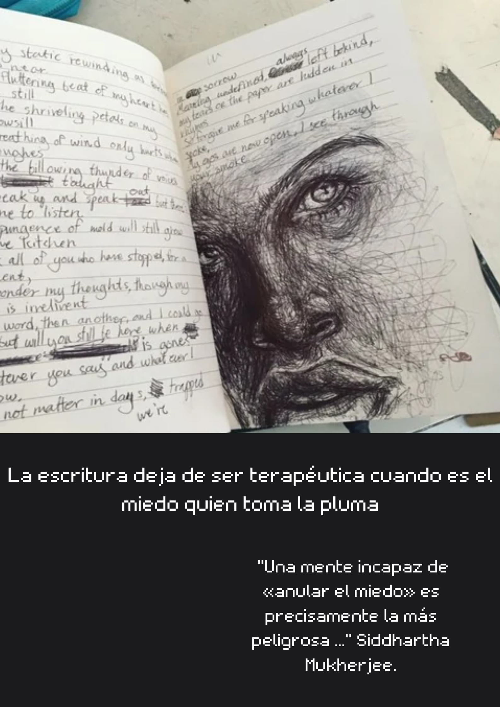

{:width="300" style="float: right"} 

##### Alicia Berenson

{:width="300" style="float: left"}De ojos azules profundos, rostro de simetría perfecta, larga melena pelirroja, hombros huesudos, piel translúcida. Estuvo felizmente casada con Gabriel, durante siete años. Ambo serán artistas:  ella era una brillante pintora, cada vez más cotizada y él un fotógrafo de prestigio, con una vida aparentemente perfecta. Alicia admira a Gabriel y estaba totalmente enamorada de él, ama y adora a su marido, como ella misma lo expresa en su diario:   ´´Amo muchísimo a Gabriel. Es, sin lugar a dudas, el amor de mi vida.  Lo quiero de una forma tan completa, tan absoluta, que a veces ese sentimiento amenaza con superarme´´.  

Nació en Cambridge. Allí pasó los primeros dieciocho años de su vida, donde se había formado su personalidad. Alicia no tenía  más de diez  años cuando ocurrió el accidente de tráfico en el que murió su madre, que no fue tal, según palabras de la  misma Alicia:  ´´He pensado en mi madre. ¿Estaba loca? ¿Por eso lo hizo? ¿Por eso me ató con el cinturón de seguridad al asiento del acompañante de su mini amarillo y aceleró hasta estrellarnos contra esa pared de ladrillo rojo? ´´.  

Luego de la muerte de la madre oye a su padre decir que ella era la que debió morir y no su madre. De ahí, que el asesinato de Gabriel tenía unos orígenes más antiguos y más profundos en un trastorno de su mundo interior.  Intentó suicidarse  con una sobredosis después de la muerte de su padre. Había heredado  una fortuna de Vernon  Rose.  Precisamente, en este ejemplo se explica:  ´´La furia asesina, la furia homicida, no nace en el presente. Se origina en ese territorio anterior a la memoria, en el mundo de la primera infancia, a causa de abusos o malos tratos a una edad temprana, y con el paso de los años va acumulando carga hasta que estalla; a menudo contra un blanco equivocado´´.  

Alicia contaba con un largo historial de problemas de salud mental, que se remontaban a su infancia a través de cambios de humor, ira, arrebatos violentos, romper cosas hasta destrozarlo todo. Esa inestabilidad emocional la refleja en su diario que fue un regalo de Gabriel, era más bien, un pequeño cuaderno de tapas de cuero negro y unas páginas blancas y gruesas. Su marido le sugiere la idea de escribir.  Al principio se muestra reacia, pero  luego, acepta la propuesta para calmar la preocupación de Gabriel por su estado emocional.  Lo escribió durante los meses anteriores hasta las semanas previas a la muerte de su esposo, donde va relatando sus inquietudes y sentimientos más íntimos del pasado, con algún salto temporal a la actualidad.  Así, nos adentramos en su psique, y observamos que:  ´´A juzgar por la letra, lo había escrito en un estado mental caótico´´.  Entendiendo, una mente llena de pensamientos atrapados, repetidos, acciones olvidadas y agotamiento mental.  

En la novela, ya hace seis años que Alicia Berenson, una noche, según la evidencia encontrada, le disparó cinco tiros en la cabeza a su marido. Nadie acierta a entender qué la impulsó a llevar a cabo el asesinato de Gabriel.  Después ella trató de quitarse la vida. Conservaba cortes profundos que le cruzaban las venas en las muñecas, la llevaron al Royal Free Hospital.  Sufrió un colapso y quedó inconsciente; pero sobrevivió. Se autolesionaba con cualquier cosa que llegara  a sus manos.

Es acusada del homicidio de su marido e internada en un psiquiátrico. No ha vuelto a pronunciar palabra, ni siquiera para tratar de defenderse en el juicio que se le siguió. La única pista sobre la que indagar es un cuadro que pintó en los días siguientes al crimen, que tituló Alcestis. Theo Faber se entera de que el nombre hace alusión a una tragedia  escrita por Eurípides en la antigua Grecia, que será clave en el transcurso de la historia: ´´El cuadro es un autorretrato en el que se ve a Alicia en el estudio de su casa los días posteriores al asesinato, de pie delante de un caballete y un lienzo, con un pincel en la mano.  De él gotea pintura roja, ¿o es sangre?´´.  

Vemos  que la ruptura con  la realidad a través del silencio y la psicosis que presenta Alicia eran en parte sus formas de lidiar con el dolor insuperable causado por el hombre que amaba al descubrir su traición. No solo le había sido infiel, sino que también había sido responsable de la cadena de eventos que llevaron a la noche traumática.

De Alicia Berenson se comprende la influencia de la mente humana, el dolor y las relaciones. En resumen: el mutismo es un mecanismo de defensa, pero sus manos con el pincel y el bolígrafo gritaron su sentir ante una historia de traumas. No hay un silencio absoluto, como tampoco la herencia es determinante así sea un portador de generaciones.

{:width="300" style="float: right"}Otra reflexión, es la utilidad de herramientas. Tanto la pintura como la escritura son recursos de expresión, buscando un equilibrio entre el pensar y el sentir. En el caso de Alicia los utilizó para describir el asesinato, que se convirtieron en pistas a investigar.

Retomando ser portadora, las diferentes situaciones vividas en la infancia marcan el presente. Como Menelao en la Odisea: “La sangre de tus padres no se pierde…”  La epigenética dice que el entorno y los hábitos pueden anular la participación de los genes. En el caso de Alicia, el entorno fue determinante para reactivar la herencia. El accidente en el auto donde estaban la madre y ella, por ejemplo.

Una infancia traumada y un presente de traición. Una vez más, dependencias, obsesiones, secretos oscuros y una alarmante falta de salud mental. “Una mente incapaz de «anular el miedo» es precisamente la más peligrosa ...” Siddhartha Mukherjee.
