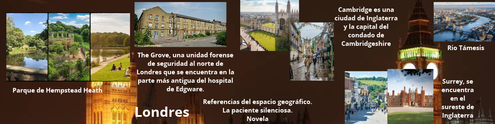

La historia se desarrolla en Londres.  La narración comienza diciendo que  Alicia Berenson vivía en la casa que compartía con Gabriel al noroeste de  Londres, junto al gran parque de Hempstead  Heath. Este es  un páramo que se encuentra en los puntos más altos de Londres, abarcando 320 hectáreas entre Hampstead y Highgate. Es un parque que contiene estanques, piscinas y bosques. Es un área de gran relevancia para la preservación natural de la metrópoli.

Después del asesinato de Gabriel, Alicia fue internada en **The Grove**, una unidad forense de seguridad al norte de Londres  que se encuentra en la parte más antigua del **hospital de Edgware**.  Era un  edificio victoriano de ladrillo rojo original, rodeado de una línea de cámaras de seguridad encaramadas a las vallas.                

**Cambridge** es una ciudad de Inglaterra y la capital del condado de Cambridgeshire. Una ciudad en la que universidad de Cambridge  ha sido el centro de industrias como la del software y la biociencia en el  tecnológico Silicon Fen, también conocido como el Cambridge Cluster.

**Surrey**, se encuentra en el sureste de Inglaterra, limitando con Londres y es un asentamiento grande  no metropolitano con once distritos y  tiene la mayor densidad de bosques de Inglaterra.  Ambos viajaban todos los días a Londres para trabajar.

Siendo **Londres**,  la mayor ciudad y  capital de Inglaterra, ubicada a orillas del rio Támesis. Fue fundada por los Romanos y conserva un perímetro medieval y un centro neurálgico para las artes, el comercio y el entretenimiento.

El **río Támesis** es el más largo de Inglaterra y el segundo del Reino Unido, atravesando Londres.

